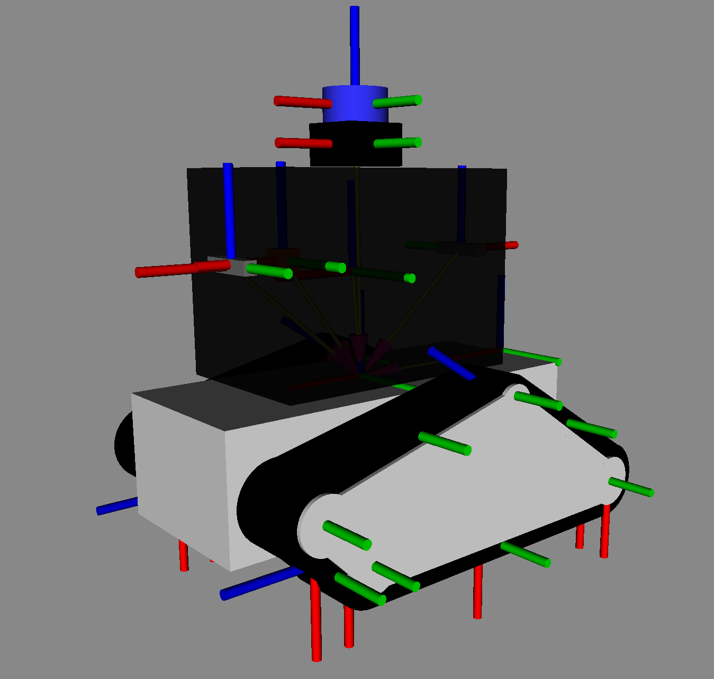

# Jo Sim
[](https://docs.ros.org/)
[](https://gazebosim.org/)
[](https://www.docker.com/)
[](https://ubuntu.com/)
[](https://navigation.ros.org/)

A comprehensive ROS 2 robot description package for the Jo tracked robot platform, featuring complete robot modeling, simulation, and navigation capabilities using Gazebo (Harmonic) and ROS 2 Jazzy.

<div align="center">
  
</div>


## Key Features

- **Complete URDF/Xacro Model**
- **Gazebo Harmonic Simulation**
- **Sensor Suite**:
  - Velodyne LiDAR (3D point cloud)
  - Front and back depth cameras (RGB-D)
  - IMU sensor for orientation/acceleration
  - Track simulation
- **Navigation Ready**: Pre-configured Nav2 stack for autonomous (mapless) navigation 
- **Docker Support**: Full containerized environment with GPU acceleration
- **RViz Visualization**: Pre-configured visualization configs for display, simulation, and navigation


## Packages
+  ```jo_description``` - URDF model of the robot, complete with sensors
+ ```jo_sim``` - Simulation package: Gazebo world, robot, sensor bridges, driver emulation and the jo_bringup-equivalent launch
+ ```jo_navigation``` - Package containing configs and launch files for localization and navigation


# Quick Start

## Prerequisites
To correctly install the docker with GPU access, these steps need to be followed:
1. Install Docker Engine with their [guide](https://docs.docker.com/engine/install/ubuntu/)
2. Allow Docker usage as non-root user ([guide](https://docs.docker.com/engine/install/linux-postinstall/))
3. Correctly install [nVidia drivers](https://github.com/oddmario/NVIDIA-Ubuntu-Driver-Guide)
4. Install the [`nvidia-container-toolkit`](https://docs.nvidia.com/datacenter/cloud-native/container-toolkit/latest/install-guide.html)

## Building and Running

### 1. **Start and build the docker image**:
```bash
docker compose up --build
```

### 2. **Access the container**:
```bash
docker compose exec jo-sim bash
```

### Configuration
`.env` holds the build options (`BUILD_RTABMAP`, `GLIM_ROS_REF`, `DENDROS_VERSION`, `BUILD_JOBS`, `CUDA_ARCHS`) and runtime settings. RTAB-Map (visual odometry / visual SLAM) is built from source only with `BUILD_RTABMAP=true`; without it the localization stack runs without visual odometry.

Mounted folders: `user_worlds/` (your worlds), `saved_maps/` (GLIM and RTAB-Map maps), `bags/`, `docker/utils/` (aliases, CycloneDDS config; editable without rebuilding).

### Inside the Container

The simulator exposes the **same ROS interface as the real robot** (jo-zotac): same topics, frame ids and TF ownership. The stack runs unchanged on top of it with `use_sim_time:=true`.

#### Same commands as the robot
`sim_bringup.launch.py` accepts the flags of `jo_bringup.launch.py`, and the aliases have the same names as in jo-zotac:
```bash
full_navigation                       # front/back cameras + localization + local navigation + RViz
full_gps_navigation                   # + GNSS, GPS localization and navigation
ros2 launch jo_sim sim_bringup.launch.py localization:=true world:=office_cpr x:=2.0 yaw:=1.57
```
Simulator-only arguments: `world`, `gui`, `follow` (Gazebo GUI camera follows the robot, default on), `x y z yaw`, `latitude longitude elevation` (GNSS datum for worlds without `<spherical_coordinates>`), `sim_noise` (sensor noise on/off, default on), `lidar_range_stddev`, `glim_config`, `glim_anchor_frame` (default `base`).

#### Simulator only
```bash
sim                                   # world + robot + all sensors + RViz
sim_worlds                            # list the worlds that can be loaded by name (with check_worlds results)
check_worlds                          # test which worlds load and run in real time
teleop                                # keyboard teleop
```

#### Worlds
Drop a `.sdf` / `.world` file (with an optional `models/` folder next to it) in `user_worlds/` and launch it by name: `sim world:=my_world`. Worlds are searched in `user_worlds/`, `jo_sim/worlds/` and the [external collection](https://github.com/leonhartyao/gazebo_models_worlds_collection.git). The world is patched automatically (a copy in `/tmp/jo_sim/worlds`, the original is not touched):
- the world systems the robot needs (physics, sensors, RGL lidar) and `<spherical_coordinates>` are added when missing;
- Gazebo Classic worlds: `model://sun` / `model://ground_plane` are written inline, models that are not available locally are downloaded from [Gazebo Fuel](https://app.gazebosim.org/OpenRobotics) on first use (with their dependencies, into `user_worlds/.cache/models`), Ogre material scripts (ignored by Harmonic, models would be untextured) are converted to PBR textures in copies of the models (`user_worlds/.cache/converted_models`), heightmap terrain is rescaled to the heights Classic gave it, `<road>`s are drawn, duplicate model names are made unique. Note: the simulated lidar does not see heightmap terrain (RGL limitation).

Loading is not enough: some Classic worlds run far below real time in Harmonic (e.g. `warehouse`, RTF ≈ 0.003: stacked dynamic boxes on mesh shelves). Test them once with
```bash
check_worlds                 # all worlds, ~30 s each, headless, does not disturb a running sim
check_worlds warehouse cafe  # only some
sim_worlds                   # list with the result: ok / slow / fails
```
Results are kept in `user_worlds/.cache/world_status.json`.

#### Simulated sensors
| Real sensor | Topics | Frame |
|---|---|---|
| Velodyne VLP-16 (RGL) | `/velodyne_points` (x y z intensity ring time), `/scan` (velodyne_laserscan) | `velodyne` |
| Xsens MTi | `/imu/data` | `imu_link` |
| Xsens GNSS | `/gnss` | `imu_link` |
| RealSense D456 front/back | `/<cam>_camera/camera/color/image_raw`, `.../color/camera_info`, `.../aligned_depth_to_color/image_raw`, `.../aligned_depth_to_color/camera_info`, `.../depth/color/points` | `<cam>_camera_color_optical_frame` (cloud: `<cam>_camera_depth_frame`) |
| Bunker base | `/cmd_vel` (no odometry, as on the robot) | |

The RealSense TF tree below `<cam>_camera_link` is published by the simulator (`driver_emulation.launch.py`), as the driver does on the robot.

`sim_noise:=false` turns off all sensor noise: IMU (Xsens MTi datasheet values), GNSS (RTK, 2 cm), colour images, lidar range (added by `velodyne_emulation`, as the RGL plugin has no noise model).

The Velodyne emulation holds back the lidar for the first 2 s of sim time (`startup_hold` parameter of `velodyne_emulation`): the robot is spawned slightly above the ground and drops, and GLIM must initialize with the robot at rest.

GPS localization in the sim:
- **Heading:** the sim passes the spawn `yaw` to navsat_transform as `navsat_yaw_offset`. Gazebo is
  east-north-up; the robot's 1.57 is for the Xsens, whose yaw reads 0 at north.
- **Participant limit:** the CycloneDDS config allows up to 100 participants per domain (default 32,
  too few for the full GPS stack).

#### glim_ros2 development
To test a local checkout of glim_ros2, uncomment its volume in `compose.yaml` and set `EXTRA_BUILD_PACKAGES=glim_ros` in `.env`: it is rebuilt at container start.

See [PLAN.md](PLAN.md) for the roadmap.

## Additional Resources

- [ROS 2 Documentation](https://docs.ros.org/)
- [Gazebo Documentation](https://gazebosim.org/)
- [Navigation2 Documentation](https://navigation.ros.org/)
- [URDF Documentation](http://wiki.ros.org/urdf)
- [ROS 2 Control Documentation](https://control.ros.org/)

