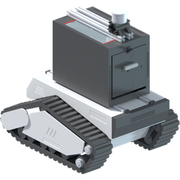
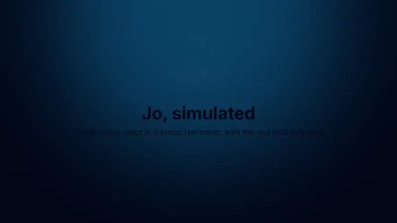

<div align="center">
  
</div>

# Jo Sim

[](https://mlisi1.github.io/jo_sim)
[](https://docs.ros.org/en/jazzy/)
[](https://gazebosim.org/)
[](https://www.docker.com/)
[](https://ubuntu.com/)

The Gazebo Harmonic / ROS 2 Jazzy simulator of **Jo**, a tracked robot. It exposes the **same ROS
interface as the real robot** (topics, message types, frame ids, TF ownership, rates), so the
robot's own navigation stack (GLIM, EKF, Nav2) runs on it unchanged, with `use_sim_time:=true`.

<div align="center">
  
</div>

**Documentation: https://mlisi1.github.io/jo_sim**: install, first run, navigation, worlds,
sensors, scenarios, the developer guide and a guide for agents.

## Features

- **Sensors as the real drivers publish them:** Velodyne VLP-16 (RGL lidar, with the driver's
  `ring` and `time` fields and `/scan`), Xsens IMU and GNSS, and two RealSense D456 (colour, aligned
  depth in 16-bit millimetres, point clouds), with noise from the datasheets. Tracks driven by
  `/cmd_vel`.
- **The robot's stack:** GLIM and EKF localization, Nav2 local and GPS navigation, and optional
  RTAB-Map visual odometry.
- **Drop-in worlds:** 51 worlds from a Gazebo Classic collection, patched on load, 23 of them usable
  with the robot, plus your own in `user_worlds/`. A sidecar yaml gives a world its spawn poses and GNSS datum. Moving
  obstacles can be added to any world.
- **Ground truth** on `/sim/ground_truth/odom`, for evaluation only: the stack never sees it.
- **Scenarios:** headless missions with pass criteria checked against the ground truth
  (`./jo scenario office_out_and_back`), for local and GPS navigation.
- **Simulation control:** pause, step and real-time factor.
- **One wrapper, `./jo`,** around a Docker image with GPU acceleration, plus
  [DendROS](https://github.com/mlisi1/DendROS) and [Testudo](https://github.com/mlisi1/testudo)
  for launch and topic health.

## Quick start

Requirements: Linux with X11, an NVIDIA GPU with its driver, Docker and the
[NVIDIA Container Toolkit](https://docs.nvidia.com/datacenter/cloud-native/container-toolkit/latest/install-guide.html).

```bash
git clone --recurse-submodules -b dev https://github.com/mlisi1/jo_sim.git && cd jo_sim
./jo sim                         # builds the image the first time; office_cpr, Gazebo GUI + RViz
./jo sim -n local                # + GLIM/EKF localization and Nav2 (= full_navigation)
./jo sim -w small_city -n gps    # GPS navigation (= full_gps_navigation)
./jo help
```

The first build takes about an hour, and the image is about 12 GB. See
[Install](https://mlisi1.github.io/jo_sim/getting-started/install/).

## Repositories

| Path | What |
|---|---|
| `jo_sim` | The simulator package: worlds, bridges, driver emulation, the `jo_bringup`-equivalent launch, scenarios |
| [`jo_description`](https://github.com/mlisi1/jo_description) | The robot's URDF. Its joints and origins are the real robot's TFs |
| [`jo_navigation`](https://github.com/mlisi1/jo_navigation) | Localization and navigation configs and launch files, shared with the robot |
| [`testudo`](https://github.com/mlisi1/testudo) | Topic health checker |
| `jo_sim/worlds/external` | A [collection of Gazebo worlds](https://github.com/leonhartyao/gazebo_models_worlds_collection) |

## For contributors and agents

Read [AGENTS.md](AGENTS.md) and the [For agents](https://mlisi1.github.io/jo_sim/agents/) page
before changing anything. [PLAN.md](PLAN.md) holds the roadmap, the current state and the decisions.
