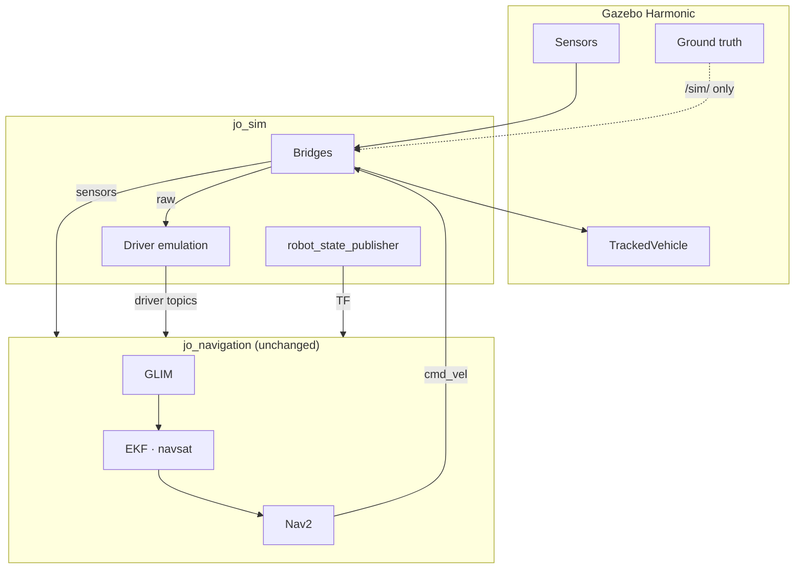

# Architecture

| Arrow | Topics |
|---|---|
| raw | `/sim/velodyne_points_raw`, `/sim/<cam>_camera/points_raw` |
| sensors | `/imu/data`, `/gnss`, the camera images and infos, `/clock` |
| driver topics | `/velodyne_points`, `/scan`, `/<cam>_camera/camera/depth/color/points`, the RealSense TF tree |
| TF | the URDF tree, from the same URDF as the robot |
| cmd_vel | `/cmd_vel` → `/model/jo/cmd_vel` |
| `/sim/` only | `/sim/ground_truth/odom`, for evaluation; the stack never reads it |

- **Gazebo** runs the patched world and the robot model. The model comes from the same URDF the
  robot uses; the sim-only parts live in `<gazebo>` tags, which `robot_state_publisher` ignores.
- **Bridges** move the sensor topics into ROS. Raw topics that the real drivers don't publish
  are bridged under `/sim/...`, and driver emulation turns them into the driver's topics.
- **Driver emulation** reproduces what the drivers do besides the sensor itself: the Velodyne
  fields, range limits and noise, the RealSense TF tree, the camera cloud frame.
- **The stack** from `jo_navigation` runs unchanged, with `use_sim_time:=true`.

## Who publishes which TF

| Frames | Robot | Simulator |
|---|---|---|
| URDF tree (`base_link`, sensors) | robot_state_publisher | the same, from the same URDF |
| below `<cam>_camera_link` | RealSense driver | `realsense_tf` |
| `odom` → `base_link` | the EKF | the same |
| `map` → `odom` | GLIM | the same |
| wheel odometry | none (`odom_frame: none`) | none: TrackedVehicle's odometry is not bridged |

!!! planned "Planned content (G3)"
    - The launch graph.
    - A per-sensor data flow, with rates.
    - The TF tree, generated from the URDF.
