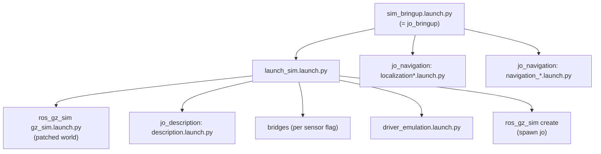

# Launch files

- **`sim_bringup.launch.py`:** the robot's entry point, with the same flags and defaults as
  `jo_bringup`. It includes `launch_sim` and the stack, and computes the navsat yaw offset from the
  resolved spawn yaw.
- **`launch_sim.launch.py`:** resolves the world and its settings (command line > sidecar >
  defaults), writes the patched world, then starts Gazebo, the clock bridge, the spawn, the bridges
  and driver emulation.
- **`driver_emulation.launch.py`:** the driver parts; follows the sensor flags.

!!! planned "Planned content (G3)"
    A line-by-line walkthrough, and how to add an argument end to end.
