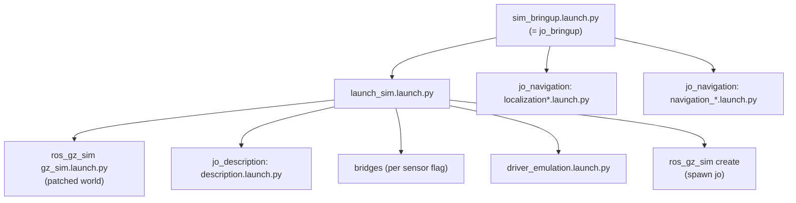

# Launch files

- **`sim_bringup.launch.py`:** the robot's entry point, with the same flags and defaults as
  `jo_bringup`. It includes `launch_sim` and the stack, and computes the navsat yaw offset from the
  resolved spawn yaw.
- **`launch_sim.launch.py`:** resolves the world and its settings (command line > sidecar >
  defaults), writes the patched world, then starts Gazebo, the clock bridge, the spawn, the bridges
  and driver emulation.
- **`driver_emulation.launch.py`:** the driver parts; follows the sensor flags.

## `launch_sim.launch.py`, step by step

1. **Arguments.** The world, the GUI and timing arguments, the spawn pose and the GNSS datum are
   declared by hand. The sensor flags (`lidar`, `imu`, `gnss`, `front_cam`, `back_cam`) are
   generated from `SENSOR_BRIDGES`, the map from a sensor flag to its bridge configs. Every
   description ends up in the [launch arguments](../user-guide/launch-arguments.md) table.
2. **The robot model.** It includes jo_description's `description.launch.py` with
   `use_sim_time:=true`, `use_ros2_control:=false` and `sim_noise`. `robot_state_publisher`
   publishes `/robot_description` and the static URDF tree.
3. **World and Gazebo: `world_and_gazebo`, an `OpaqueFunction`.** It runs when the launch starts,
   because it needs the argument values as strings. In order:
    - it resolves the world and its settings (command line > sidecar `<world>.yaml` > defaults),
      in `world_tools.world_settings`;
    - it checks `rtf`, loads `obstacles`, and writes the patched world with
      `world_tools.prepare_world` (see [World preprocessor](world-preprocessor.md)). Each patch
      is logged as a `[jo_sim]` line;
    - it builds the Gazebo arguments: `-r` unless `paused`, and `-s --headless-rendering` without
      the GUI;
    - it adds the world's model folders to `GZ_SIM_RESOURCE_PATH`, and jo_sim's `lib/` to
      `GZ_SIM_SYSTEM_PLUGIN_PATH` (for `WaypointMover`);
    - it includes `ros_gz_sim`'s `gz_sim.launch.py` with `on_exit_shutdown`: closing Gazebo ends
      the launch;
    - it starts `gui_follow` when the GUI and `follow` are on;
    - it bridges the clock from `/world/<name>/clock`, not the root `/clock` (see
      [Design decisions](decisions.md));
    - it spawns `jo` from `/robot_description` at the resolved pose.
4. **Bridges.** `core.yaml` always runs (`/cmd_vel` in, the ground truth out). Each sensor's yaml
   runs under its flag. The colour images go through `ros_gz_image`'s `image_bridge`, with one
   remap per image_transport topic: image_transport doesn't apply the base remap to its plugin
   topics.
5. **Driver emulation.** `driver_emulation.launch.py` declares no arguments. It reads the
   including launch's flags with `context.launch_configurations.get(name, 'true')`.
6. **RViz** with `sim.rviz`, under `sens_rviz`.

## `sim_bringup.launch.py`

It declares jo_bringup's flags, with the same names and defaults, plus `glim_config` and
`glim_anchor_frame`. Then it includes `launch_sim` and, under each flag, the stack's launch files
from jo_navigation, with `use_sim_time:=true`. For GPS localization it resolves the spawn yaw the way
`launch_sim` does and passes it as `navsat_yaw_offset`. Gazebo is ENU and GLIM starts at the spawn
heading; the robot's 1.57 is for the Xsens.

The simulator arguments (`world`, `gui`, `x`, ...) are not declared here. Arguments given on the
command line reach the included `launch_sim` anyway.

## Adding an argument, end to end

Say you add `lidar_max_range`:

1. **Declare it** in `launch_sim.launch.py`, with a default and a description. The description is
   the documentation.
2. **Use it.** Inside an `OpaqueFunction`: `LaunchConfiguration('lidar_max_range').perform(context)`.
   In `driver_emulation.launch.py`: `context.launch_configurations.get('lidar_max_range', '130.0')`,
   with the same default, because that file declares nothing.
3. **If the robot model needs it,** forward it in the `description.launch.py` include and add the
   xacro argument in jo_description. Use it only inside `<gazebo>` tags: joints and origins are the
   real robot's TFs ([Invariants](invariants.md)).
4. **`sim_bringup` needs nothing.** Declare it there only if it is a jo_bringup flag, with
   jo_bringup's name and default.
5. **`./jo`** passes `name:=value` through unchanged. Add a short option to `sim()` in `jo` only for
   something used often.
6. **Docs:** run `python3 docs/gen/gen_tables.py` (the arguments table), and
   `python3 docs/gen/gen_topics.py` if a topic, rate or node parameter changes. Then
   `mkdocs build --strict`.
7. **Test** in a sandbox: `./jo --domain 77 --partition jo_sim_test sim --headless --no-rviz lidar_max_range:=50`.
