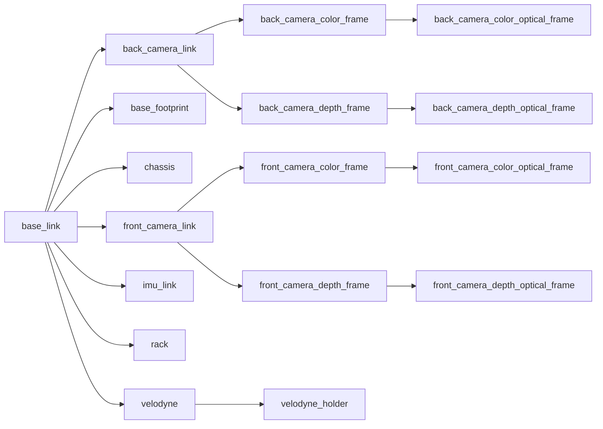

<!-- Generated by docs/gen/gen_topics.py: do not edit by hand. -->

All 36 transforms are static (`/tf_static`). The track geometry (20 frames: rollers, belts and covers) is left out: `back_left_roller`, `back_right_roller`, `front_left_roller`, `front_left_upper_roller`, `front_right_roller`, `front_right_upper_roller`, `left_back_bottom_belt`, `left_back_top_belt`, `left_bottom_belt`, `left_cover`, `left_front_bottom_belt`, `left_front_top_belt`, `left_top_roller`, `right_back_bottom_belt`, `right_back_top_belt`, `right_bottom_belt`, `right_cover`, `right_front_bottom_belt`, `right_front_top_belt`, `right_top_roller`.
